# September 15 - First work with the nRF52840 and Zephyr

Today I started the actual work on the project.

I chose the Nordic nRF52840 and Zephyr even though I had not built a larger project on this platform or in C before. I wanted to get the whole workflow working first, from writing the code to building it, flashing the board and debugging it.

I wrote a few simple test programs, including basic GPIO control and a blink test. That gave me a practical way to understand how a Zephyr project is structured and where the hardware configuration fits into it.

By the end of the day I had the development environment working properly and a basic code structure ready for the actual tester instead of just standalone examples.

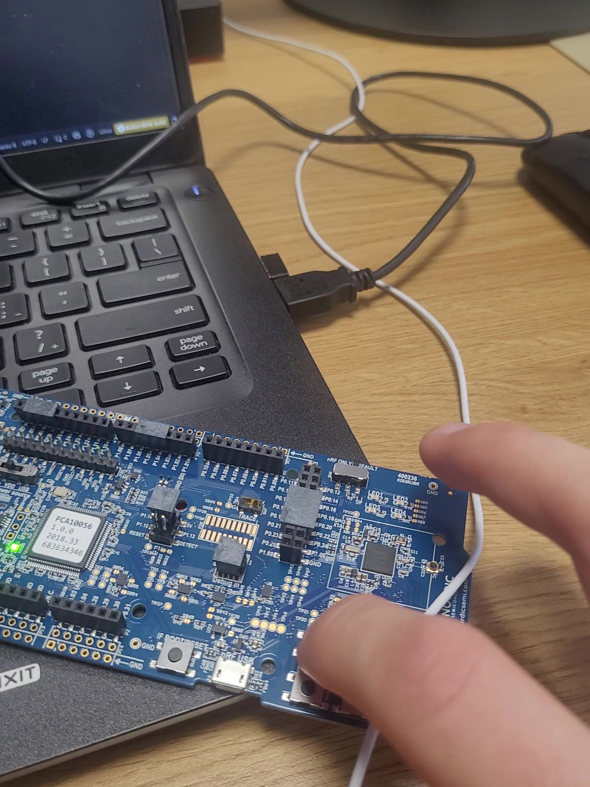

*Authentic frame extracted at approximately 00:06 from the September 15 board-test video; extracted for this documentation update.*

- [First Zephyr board test](pictures/camera/zephyr-first-board-test.mp4)
- [Flashing and board bring-up](pictures/camera/flashing-and-board-bringup.mp4)

**Total time spent: 5 hours**

# September 16 - Flow measurement and first turbine control

Today I connected the first real sensor used in the project, an Omron D6F-P0001A1 flow sensor.

I started by configuring the ADC on the nRF52840 and reading the analog output from the sensor. Raw ADC values were not very useful on their own, so I started working on converting them into voltage and then airflow in ml/min.

After a few corrections the readings became stable enough to use in the rest of the program.

Later I moved on to turbine control. I first tested PWM on a simple load and only then moved the output to the pin intended for the turbine.

By the end of the day I had both parts working together. The firmware could measure airflow and control the device generating it.

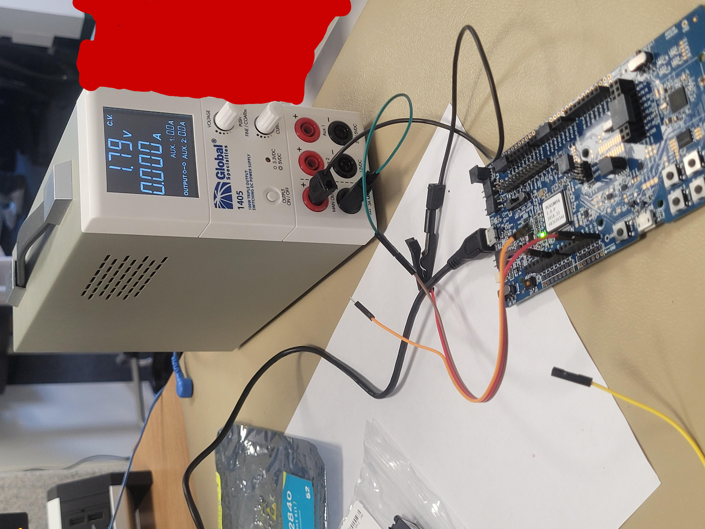

*nRF52840 connected on the bench beside the power supply.*

- [ADC readings over the serial connection](pictures/camera/adc-serial-readings.mp4)
- [Bench power supply test](pictures/camera/bench-power-supply-test.mp4)

**Total time spent: 7 hours**

# September 17 - Reading the pressure sensor over SPI

Today I added the Honeywell pressure sensor and started working with SPI.

The communication itself looked simple at first, but getting it configured correctly in Zephyr took more work than I expected. I had to set up the bus, pin assignments, chip select and the sensor configuration before the received data became reliable.

The first bytes coming from the sensor were not a ready pressure value either. The sensor includes status information together with the measurement, so I had to separate those bits first and then convert the remaining data into a physical pressure value.

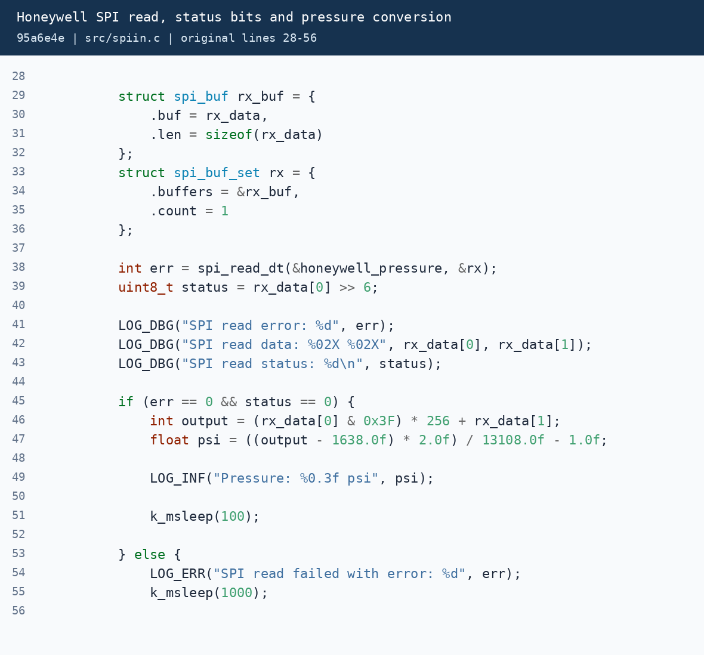

*Code image rendered for this update from [`src/spiin.c`, lines 28-56, commit `95a6e4e`](https://github.com/Artisfera/Enclosure-leak-tester/blob/95a6e4e/src/spiin.c#L28) (September 17). This preserves the historical implementation, including its original conversion; it is not a screenshot captured that day.*

I also moved the pressure sensor code into its own source file. At this point the project already included ADC, PWM and SPI, so keeping everything inside one `main.c` file would have become messy very quickly.

At the end of the day pressure and airflow measurement were both working in the same project.

**Total time spent: 7 hours**

# September 18 - First complete tester software

Today I combined the separate pieces from the previous days into one working demonstration program.

Until now the flow sensor, pressure sensor and turbine control had mostly been tested independently. I connected them into the first complete measurement sequence.

The program can start the turbine and monitor the pressure rise inside the enclosure. Once the target pressure is reached, the turbine can be stopped and the software continues monitoring pressure and airflow for a defined period.

It is still an early version of the measurement method, but this was the first time the whole sequence could run automatically from start to finish.

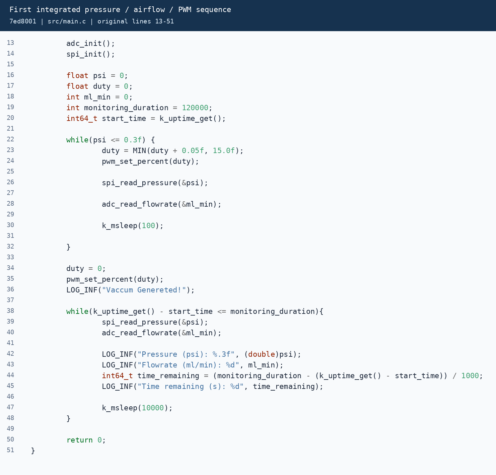

*Code image rendered for this update from [`src/main.c`, lines 13-51, commit `7ed8001`](https://github.com/Artisfera/Enclosure-leak-tester/blob/7ed8001/src/main.c#L13) (September 18), the first integrated version found in Git. Original code is preserved, including the timer placement; this is not a screenshot captured that day.*

The test also showed a weakness in the original control approach. A fixed PWM value does not give the same airflow under every condition. The turbine operating point changes together with pressure and the resistance of the pneumatic system.

That meant fixed PWM control would not be enough if I wanted repeatable measurements.

**Total time spent: 7 hours**

# September 21 - Controlling the turbine with PID

Today I replaced the simple turbine control with my first PID controller.

Instead of using a fixed PWM duty, the firmware now compares the measured value with the setpoint and continuously corrects the turbine output.

I implemented the controller myself rather than using a ready library. I wanted to understand how the proportional, integral and derivative parts behaved in the real system and not just treat the controller as a black box.

I also added real timing between control loop iterations. The integral and derivative terms depend on time, so assuming that every loop takes exactly the same amount of time would make the controller less predictable.

For the first tests I limited the maximum turbine output as well. With badly chosen parameters, a controller can react far too aggressively to a large error, so keeping the available range limited made the early tests much safer and easier to understand.

By the end of the day the closed loop was working and the measured value directly affected the next PWM setting.

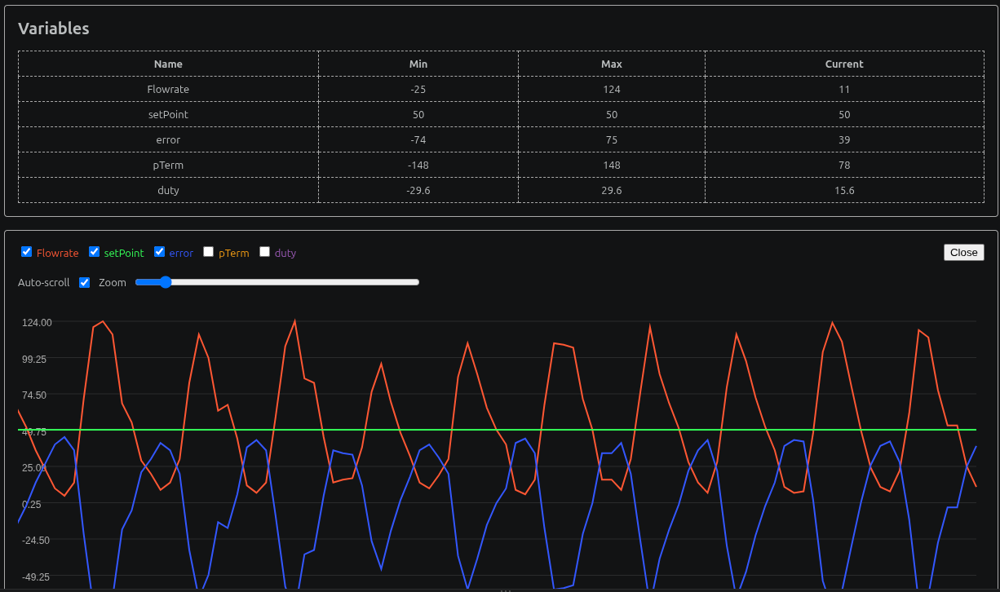

*Early PID response showing oscillations during controller development.*

**Total time spent: 7 hours**

# September 22 - PID tuning and first physical test setup

Today I focused on tuning the controller on a real setup.

I tested different values of Kp, Ki and Kd and watched how they changed the response time, overshoot and overall stability.

Reading everything directly from the terminal quickly became inconvenient, so I changed the serial output to make plotting easier. I printed the measured value, setpoint, error, individual PID terms and current PWM duty together.

Seeing the response on a graph made the tuning much easier. It was immediately visible when one part of the controller started dominating or when the system began oscillating.

I also assembled the first temporary test setup with the turbine and sensors, so from this point the controller was being tested with real airflow rather than only as software.

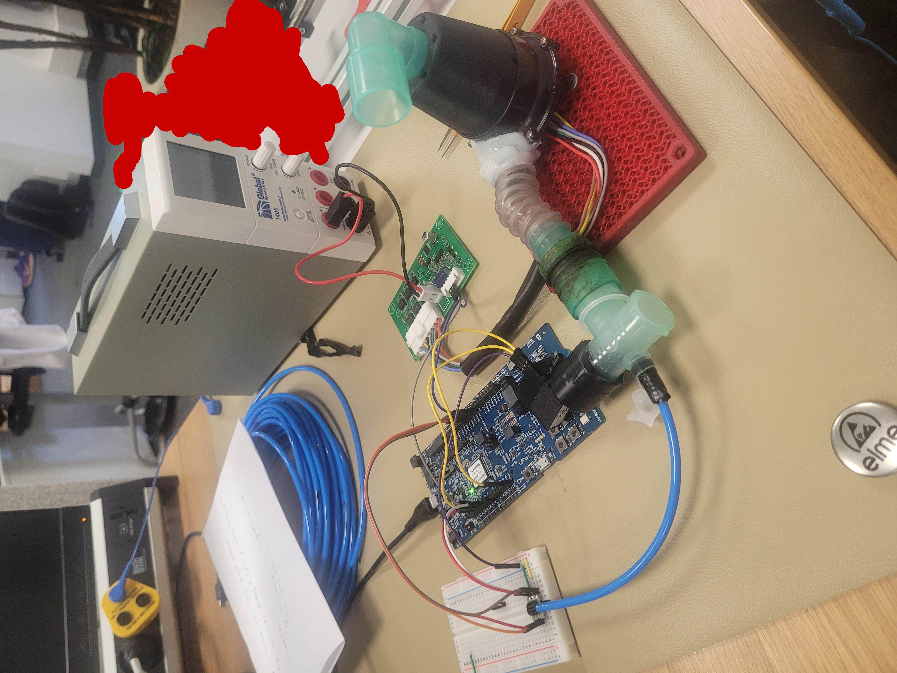

*First physical pneumatic test bench with turbine and sensors.*

This was also where the main limitation of the D6F became obvious. The sensor is very useful for small airflow because its range is only around 0 to 100 ml/min, but that same range becomes a problem when the enclosure leaks more heavily.

I wanted to keep the sensitivity of the D6F without limiting the entire tester to such a small total airflow.

*PID step response during the September 22 tuning session.*

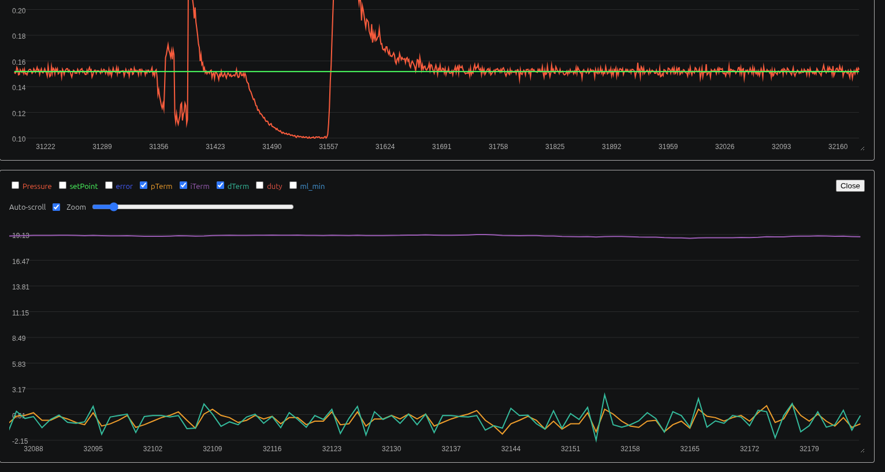

*PID transient response and individual controller terms.*

**Total time spent: 7 hours**

# September 23 - First mechanical design and the 22 mm connection

Today most of the work moved from firmware to mechanics.

I needed a proper airflow path for the tester, so I started working in FreeCAD. This was my first real project in the program and I decided to learn it directly on the part I actually needed instead of spending hours making unrelated tutorial models.

For the pneumatic connection I did not want to invent another arbitrary connector. I chose a standardized 22 mm conical connection based on geometry used in medical breathing systems.

I went through the available dimensions and started reproducing the geometry in CAD. One of the important details was that the 22 mm connection is not simply a straight cylinder. The mating surface has a defined taper, which had to be included in the model.

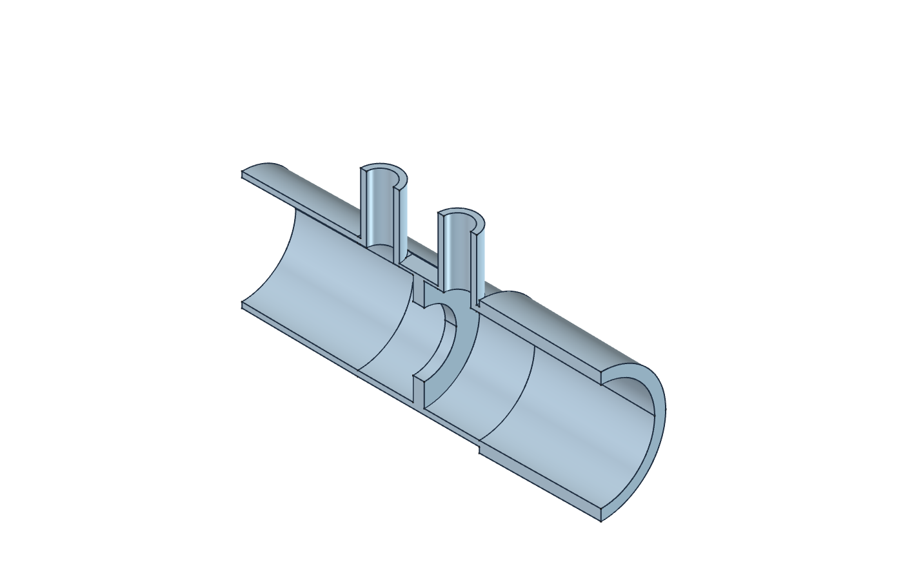

*FreeCAD section rendered for this update from [D6F-Resistance 0.0.1](https://github.com/Artisfera/Enclosure-leak-tester/blob/9b3057c/3d-models/D6F-Resistance/D6F-Resistance-0.0.1.FCStd), feature `Pocket005`, in commit `9b3057c` (September 28). This later saved model illustrates the conical connection discussed here; no September 23 CAD revision was found in Git.*

FreeCAD worked much better for this than I expected. Once I understood the basic workflow it felt much more natural than the other CAD tools I had tried before.

This tutorial helped me a lot when getting started.

https://www.youtube.com/watch?v=JjFh8vtMBC8

At the same time I started working on a way to solve the D6F range problem. The sensor itself measures only around 100 ml/min, while the main pneumatic path may eventually need to handle airflow in the tens of liters per minute and possibly close to 100 L/min.

The idea was to measure only a small fraction of the total airflow instead of sending everything through the D6F.

**Total time spent: 7 hours**

# September 24 - Modelling the airflow path in FreeCAD

Today almost all of the work was CAD.

I continued developing the 22 mm connector and started building the main airflow path around it.

I added the first version of a restriction in the main channel and prepared locations for a separate measurement path. The model quickly became more than just a simple adapter.

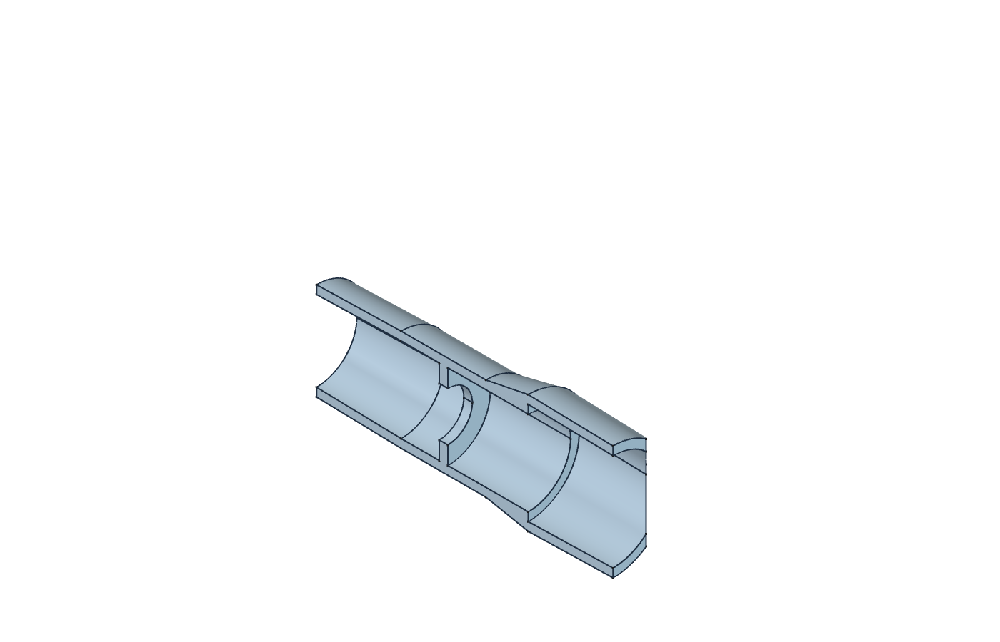

*FreeCAD section rendered for this update from [D6F-Resistance 0.2.0 (20-11.61)](https://github.com/Artisfera/Enclosure-leak-tester/blob/9b3057c/3d-models/D6F-Resistance/D6F-Resistance-0.2.0-%2820-11.61%29.FCStd) in commit `9b3057c` (September 28). This later saved geometry illustrates the airflow path; it is not a view captured on September 24.*

I also ran into several FreeCAD problems along the way. Some sketches looked closed but were not actually valid closed profiles, and the solver occasionally reported conflicting constraints that were not obvious at first.

After several failed sketches, a few crashes and more time spent understanding how FreeCAD expects the model to be structured, things finally started to make sense.

A lot of the problems were not really caused by the operations themselves. They came from how I had built the sketches and relationships between features.

By the end of the day I had the basic geometry ready for the actual D6F bypass.

**Total time spent: 5 hours**

# September 25 - 22 mm adapter and D6F-P bypass

Today I worked on the most important mechanical part of the measurement system so far.

Passing the whole airflow through the D6F would not make sense because the sensor reaches its useful limit at around 100 ml/min. Instead, I designed a bypass.

Most of the air travels through the main channel while only a small fraction passes through the D6F. I added a restriction in the main path so that a pressure difference appears between two points. That pressure difference drives airflow through the bypass and through the sensor.

This allows the D6F to stay inside its normal measurement range while the complete pneumatic system handles a much larger total airflow.

I expanded the 22 mm adapter with the main restriction, pressure pickup locations, bypass channels and the sensor mounting geometry.

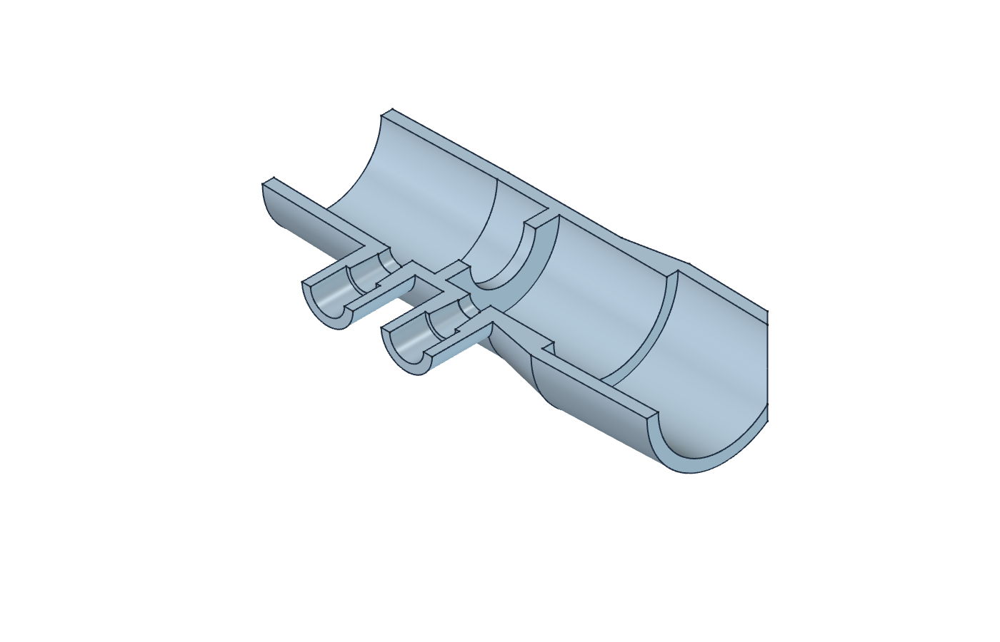

*FreeCAD cutaway rendered for this update from [D6F-Resistance 0.2.0 (20-11.61)](https://github.com/Artisfera/Enclosure-leak-tester/blob/9b3057c/3d-models/D6F-Resistance/D6F-Resistance-0.2.0-%2820-11.61%29.FCStd) in commit `9b3057c` (September 28). It illustrates the later saved bypass geometry and sensor connection locations, not a September 25 screenshot or a model of the sensor internals.*

The first restriction dimensions are only a calculated starting point. I do not expect the theoretical geometry alone to give an accurate final result. The printed surface, real channel dimensions, bypass resistance and the sensor itself will all affect the relationship between bypass flow and total flow.

The finished assembly will therefore need real calibration.

The model had also become large enough that I had to start separating and organizing the solids with printing and later revisions in mind.

I sent the parts to the printer for the weekend, so the next useful test will be with the actual hardware rather than another CAD screenshot.

I also added a 45 degree transition inside the female side of the connector. This lets the part print without internal supports. I wanted to avoid support marks inside the airflow path because they could change the surface and make the flow less repeatable.

**Total time spent: 8 hours**

# September 28 - Final adapter version and first enclosure work

Today I finished another, nearly final version of the D6F-P bypass adapter.

I kept the possibility of testing different restriction diameters and prepared the variants needed for further experiments. The adapter itself was already developed enough that I could stop focusing on its basic geometry and move on to another part of the test setup.

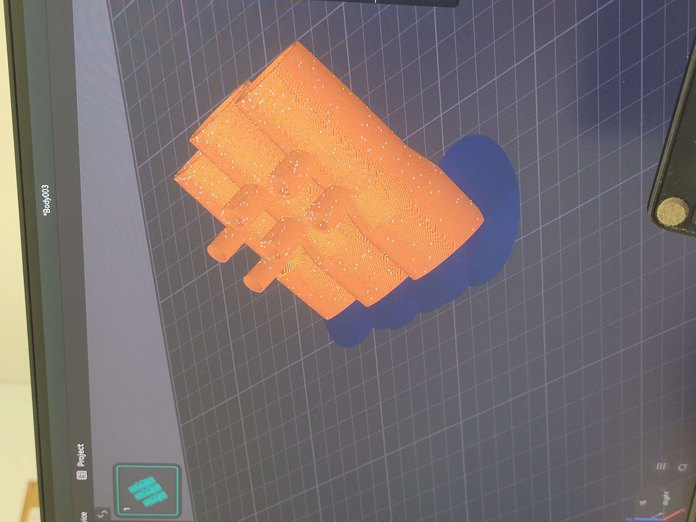

*Slicer preview of a pneumatic part prepared for printing.*

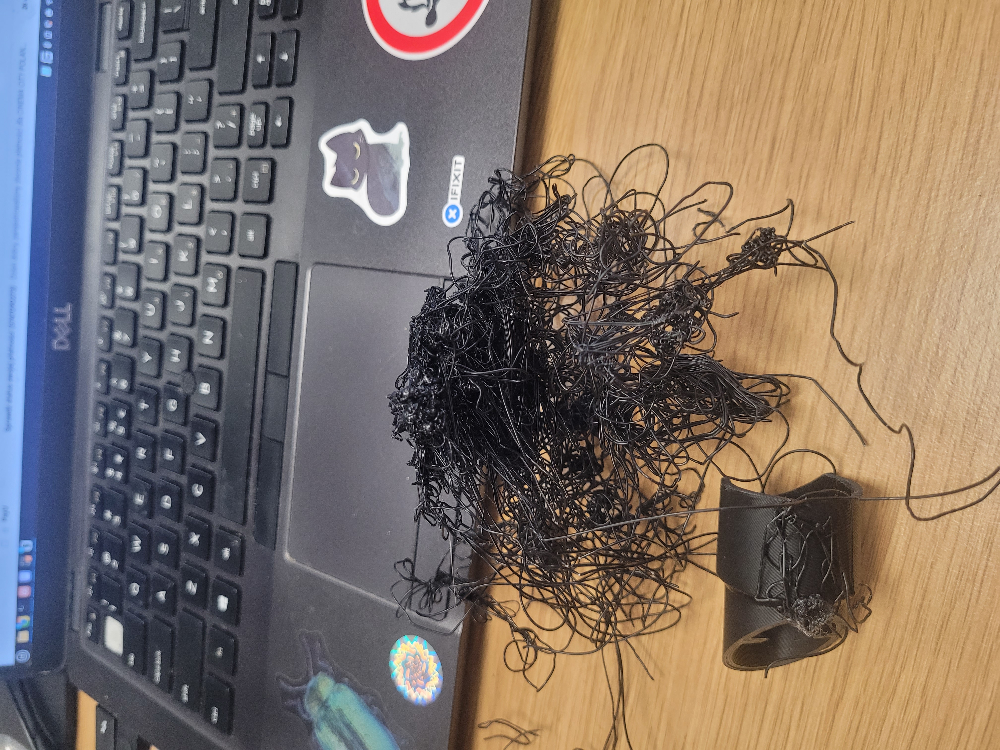

*Tangled filament after an unsuccessful print.*

I started designing the lid that will create a sealed connection between the tester and the enclosure being tested. It was a much larger part than the previous components and it quickly became clear that it required a different approach to modelling.

This part also helped me make a lot of progress in FreeCAD. Instead of treating sketches only as a way to draw a specific shape, I started using constraints and dimensional relationships much more deliberately. The model started becoming something that could be modified later without rebuilding everything from scratch.

I also cleaned up the mechanical side of the repository and added the models, printable files, documentation and an updated diagram of the tester.

**Total time spent: 5 hours**

# September 29 - Cleaning up the firmware

After several days of adding new functions, the code still contained many parts that had been created while I was learning the nRF52840, Zephyr and C. Today I started turning the earlier prototype into more organised firmware.

I removed unnecessary fragments and leftovers from earlier tests. I changed the D6F-P flow conversion to use the polynomial approximation from the Omron documentation and changed the airflow value to a `float`.

I also moved the PID controller out of `main.c` into a separate module. This made the main loop much simpler and left it mostly responsible for the sequence of operations, including reading airflow, reading pressure, calculating the PID output and updating the PWM.

I also started improving the ADC and SPI error handling. Earlier versions of the code mostly assumed that every read would succeed, which was acceptable during the first tests but not for a more complete device.

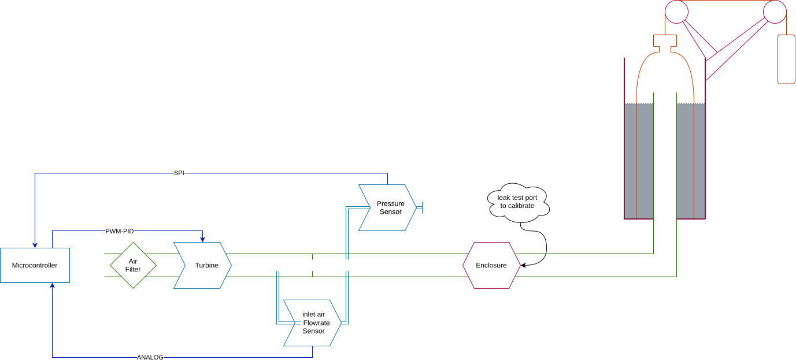

*Existing repository diagram, version 0.2.0; used here to illustrate the firmware and schematic cleanup.*

**Total time spent: 6 hours**

# September 30 - Firmware 1.0.0 and the airflow calibration problem

Today I finished a larger cleanup of the firmware. The code went through several versions before reaching `1.0.0`.

I cleaned up the ADC, SPI, PWM and PID modules, added separate error status values and improved hardware initialisation. I also moved the PID parameters into one structure so that different settings can later be used without changing the controller algorithm itself.

After bringing the firmware to this stage, a larger measurement problem still remained. The D6F-P measures only a small part of the airflow in the bypass, so the printed adapter and calculated restriction alone are not enough. I still need to determine the real relationship between the airflow through the D6F-P and the total airflow through the tester.

I started with a whiteboard brainstorming session and tried to develop a calibration method from first principles.

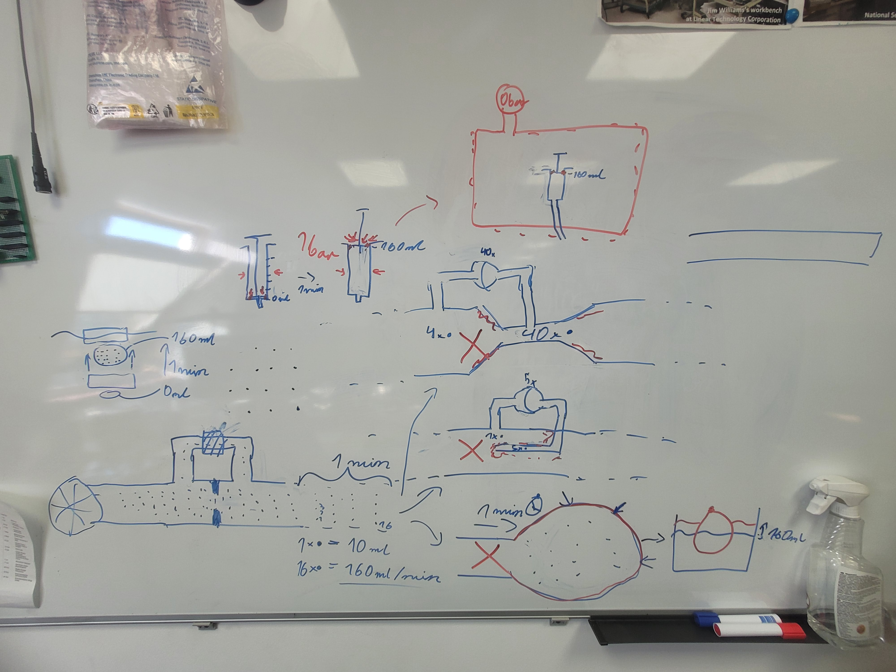

*Whiteboard brainstorming of possible airflow calibration methods.*

The first obvious ideas were a Pitot tube and a Venturi, but I rejected them fairly quickly. In a home-built setup there are too many additional variables related to geometry, flow profile and manufacturing accuracy for either method to be a reliable reference.

The next idea was a balloon with a known volume. The problem is that its walls stretch during inflation and create their own pressure, so the measurement conditions change as the balloon fills.

A large syringe seemed like a better direction. The problem there is the piston seal and static friction. At low pressure differences the piston does not move perfectly smoothly, so it is also not a good reference.

By the end of the day I had a much clearer idea of what the calibrator needed to do. It has to measure a known volume of air over a known time while adding as little and as predictable resistance to the airflow as possible.

**Total time spent: 7 hours**

# October 1 - Parametric lid and bell prover

The first lid tests revealed another mechanical problem. The large flat surface was too flexible, which made it difficult to maintain even and sealed contact with the gasket.

I redesigned the lid into a cone-like shape. The geometry itself significantly increased its stiffness without requiring the entire part to become very thick.

I also wanted to be able to test different wall thicknesses easily. This forced me to define the constraints in FreeCAD more carefully. Critical geometry such as the gasket interface and the 22 mm connector can remain unchanged while the wall thickness is treated as a parameter that can be adjusted independently.

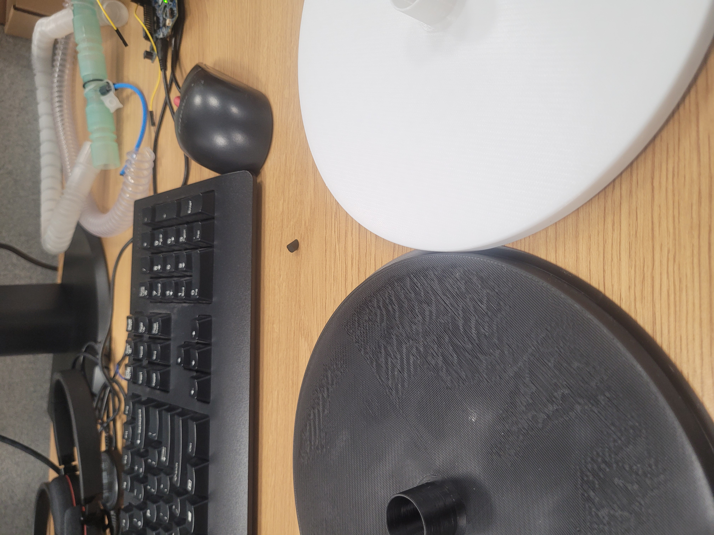

*Earlier lid prototypes photographed on September 29 (date from the original filename), shown here as context for the October 1 redesign.*

*Lid and gasket interface photographed on September 29 (date from the original filename), illustrating the sealing interface discussed here.*

This was the point where I really understood the advantage of parametric modelling. Instead of correcting several dependent dimensions after every change, I can now change one value while keeping the important design assumptions intact. After solving this, FreeCAD started to feel more suitable for this kind of work than Fusion 360.

I also returned to the airflow calibration problem. I reversed the syringe idea. Instead of moving a sealed piston inside a cylinder, the whole container can move while water is used only as the seal.

In practice, this means using an inverted container of known volume partially submerged in water. Incoming air raises the container, and the airflow can be calculated from the displaced gas volume and the elapsed time. A larger container allows the same principle to be used for much higher flow rates.

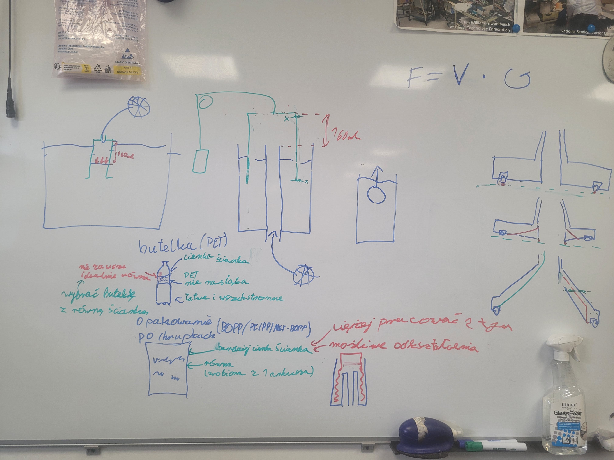

*Whiteboard notes developing the inverted-container bell prover concept.*

I also added the idea of a counterweight that can nearly balance the moving container and reduce the additional pressure required to lift it.

*Bell prover concept sketch with a counterweight.*

Only later did I find out that this was not a new invention. A very similar method already exists in gas flow metrology and is known as a **bell prover**, a volumetric displacement standard used for calibrating gas flow.

**Total time spent: 8 hours**

# October 2 - First complete electronics and PID tests

Today I started assembling the electronics in a form much closer to the actual tester and testing the whole system as one closed control loop.

On paper, all of the individual parts were already working. Pressure measurement over SPI, airflow measurement, PWM control and the PID controller had all been tested separately. Once they were combined in the real setup, several problems appeared that were not visible during individual module testing.

I fixed several issues related to initialisation and PWM control. The PID also behaved differently than it did during the earlier, more controlled tests. When the PWM output reached its maximum limit, the integral term could continue growing even though the system could no longer increase the control output. The physical setup also made it clear how important the correct controller direction is.

The most important change was the pressure sensor. The Honeywell ABP I had been using had a range that was much too large compared with the target pressure of around 50 Pa. I replaced it with a more suitable Honeywell HSC `002ND` differential pressure sensor with a much smaller measurement range.

Communication still uses SPI and the same basic Honeywell digital pressure format, but the physical pressure range represented by the output values is different. I therefore also started moving the pressure calculations from psi to pascals, which makes much more sense at such low pressures.

The electronics and the required components are now assembled together. The next step is to adapt the controller to the real setup. The earlier PID settings looked reasonable during simpler tests, but the complete system now needs a more systematic way of choosing the parameters instead of relying only on trial and error.

*Integrated turbine electronics and sensor wiring.*

**Total time spent: 8 hours**

# October 5 - PID AutoTune and calibration preparations

Today I focused on preparing for the D6F-P adapter calibration using the bell prover method and on automatically tuning the PID controller.

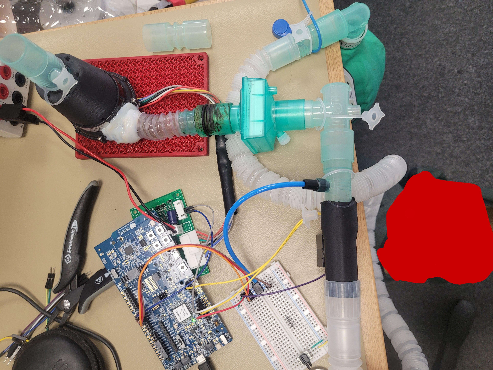

*PID test rig with the D6F-P bypass installed.*

Manually adjusting Kp, Ki and Kd was not a good long-term solution. The tester is supposed to work with different enclosures, which can have completely different volumes and leakage rates, so I needed a way to automatically find suitable PID parameters for the current conditions.

I started learning about the Åström-Hägglund relay feedback method and the Tyreus-Luyben tuning rules. The idea is to deliberately induce pressure oscillations, measure their amplitude and period, and then use those values to calculate the PID parameters.

Out of curiosity, I also decided to see how GPT-6 Astra and GPT-5.6 Terra would handle implementing the autotuner. The experiment produced promising results, but in my opinion, the resulting code was unnecessarily complicated and difficult to understand. I eventually decided to keep that version as a separate experiment and write the actual implementation myself.

I haven't finished my own autotuner yet, but I now have a much better understanding of the method itself and the mathematics behind it.

**Total time spent: 7 hours**

# October 6 - Building the bell prover calibration setup

After finding suitable PID parameters, I managed to achieve much better pressure regulation. This allowed me to return to the last major problem, which was calibrating the adapter designed to measure airflow rates much higher than the D6F-P's own measurement range.

I started building a calibration setup based on the bell prover method I had developed conceptually a few days earlier.

Since I didn't have much time left, I decided to use whatever materials I had available. I used a tall section of drainage pipe as the main water container and plastic drink bottles as the moving bells. The bottles were lightweight, easy to find and allowed me to test the method with different volumes.

To supply air, I used tubing and elbows with the medical-style connectors I had already incorporated into the tester's design.

*Bottle calibration setup with tubing and pneumatic connectors.*

The biggest compromise was the counterweight. Instead of building a separate mechanism with weights, I decided to support and lift the bottle by hand, trying to compensate for its weight and the forces caused by its immersion in water.

It wasn't an ideal measurement setup, but it allowed me to build something functional and move from the original concept to real experiments.

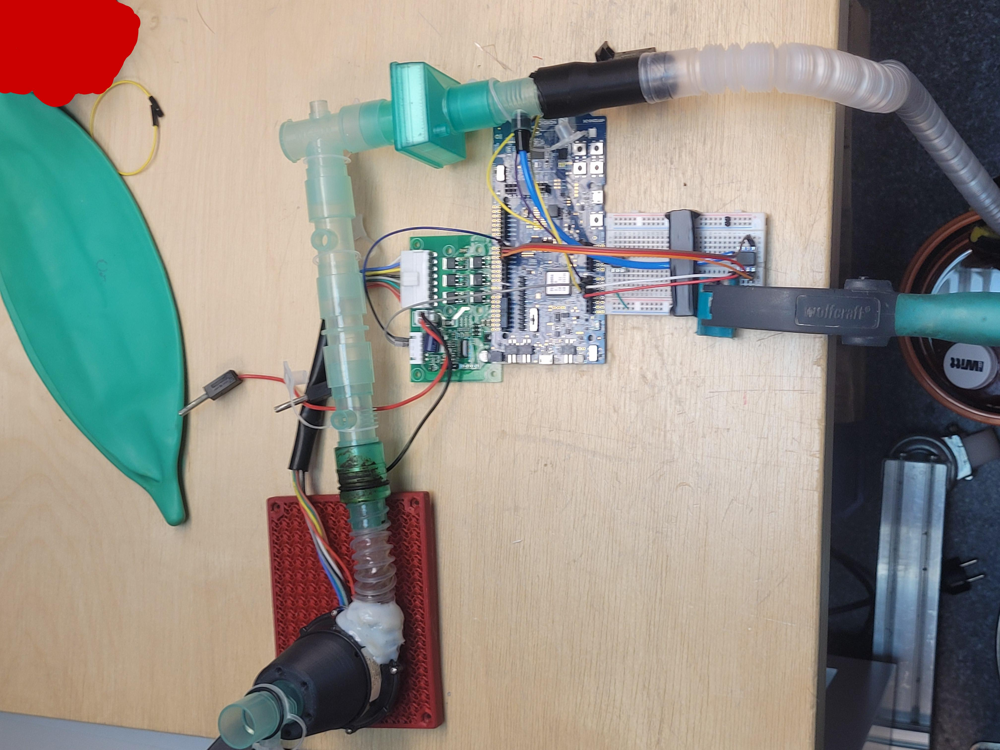

*Top view of the pneumatic calibration test rig.*

**Total time spent: 7 hours**

# October 8 - First calibration attempts and analysis of the results

Today I started testing the bell prover setup.

Unfortunately, things didn't go quite as smoothly as I had hoped. My laptop had already been giving me problems for some time, and today it was crashing particularly often, sometimes requiring a complete power reset or even a BIOS reset. Despite these interruptions, I managed to collect a series of measurements using two different bottles.

At this stage, I was mainly interested in repeatability. I wanted to check whether repeated measurements under similar conditions would produce similar results before treating the method as a reliable way to calibrate the sensor. These were uncalibrated readings, so I was comparing their consistency rather than treating them as accurate flow values.

For the 550 ml bottle, I obtained the following results.

`58, 40, 60, 88, 110, 49, 118, 25, 24, 61`

For the larger 1750 ml bottle, the results were as follows.

`128, 158, 101, 111, 123, 192, 92, 152, 123, 179`

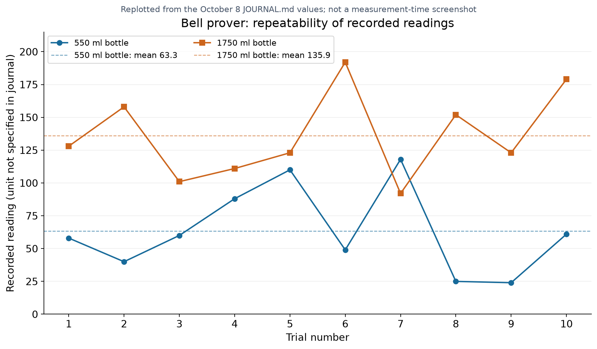

*Chart created for this documentation update from the two ten-reading series recorded above in this journal. It is not an original screenshot taken during measurement. The reading unit is not specified in the journal; ml identifies bottle volume only.*

The variation turned out to be far too large. With the 550 ml bottle, the average was 63.3, but the measurements ranged from 24 to 118. The difference between the highest and lowest readings was as much as **148.5% of the average**.

With the 1750 ml bottle, the average was 135.9, with measurements ranging from 92 to 192. The difference between the extremes was **73.6% of the average**.

The larger bottle produced a smaller relative spread, but the results were still nowhere near consistent enough for a calibration I could trust.

There were several possible reasons for this. Even though I tried to be as careful as possible, manually counterbalancing the bottle couldn't provide perfectly consistent conditions. Changes in resistance to movement, the pressure required to lift the bell and potential errors in the airflow measurement itself could all have contributed to the results.

At that point, I couldn't determine exactly which of these factors had the greatest influence. What I did know was that the current setup and measurement method were not yet reliable enough for proper calibration.

Despite that, I consider the experiment valuable. Instead of immediately using a ready-made solution, I went through developing the method, building the setup and discovering its limitations in practice. I didn't achieve the calibration I wanted, but I learned quite a lot about how difficult it can be to build a good measurement setup, even when the underlying principle seems simple.

**Total time spent: 6 hours**

# October 9 - Last day of the internship and final measurements

Today was the last day of my internship. I wanted to finish the project with something more than an unfinished D6F-P calibration, so I decided to use a Panasonic FM-215-8 industrial airflow sensor that was available on site.

It was a much more advanced instrument, capable of measuring airflow rates up to 100 L/min. It had its own display as well as an analog output that could be used to read the measured flow rate.

While trying to connect that output to my system, I noticed something I had somehow completely overlooked before. The conversion from the raw ADC reading to voltage had been implemented incorrectly in my code.

Instead of properly converting the ADC result according to its configuration, I had essentially treated the `sample` value as if it were already a voltage reading. Only then did I realise how much that simplification could have affected my measurements.

There wasn't enough time left to properly investigate and fix the entire measurement path. Discovering this mistake also meant that the earlier calibration problems might not have been caused entirely by the bell prover setup. Some of the inconsistent or incorrect readings could have come from the ADC data processing itself.

However, with the airflow reading available directly on the Panasonic's display, I could finally perform the measurements I had been preparing the tester for over the past few weeks.

I assembled the final test setup and started measuring the airflow required to maintain a constant overpressure of 50 Pa inside the tested enclosure. I continued each measurement until the reading stabilised.

*Final enclosure leak test setup used for measurements with the Panasonic airflow meter.*

First, I checked the lid seal by pressing it against a flat, airtight surface. The flow meter indicated **0 L/min**. This was only the instrument's displayed reading, not proof of a perfectly airtight seal. When I deliberately held the lid incorrectly to create a leak, the reading increased to **7.1 L/min**.

I then moved on to measuring the actual enclosure.

In the first case, I measured **16.8 L/min**, while the second measurement gave **24.6 L/min**, both at a maintained pressure of 50 Pa.

These were the first final leakage measurements performed using the complete test setup I had built and a separate airflow meter. It doesn't mean that every problem with the project has been solved, but after several weeks of work, I could finally see all the individual parts working together during a real measurement.

**Total time spent: 6 hours**

## End of the internship

And just like that, my internship came to an end.

It was an unforgettable experience. Most importantly, I managed to overcome some of my own barriers when it comes to programming. Not long ago, C, Zephyr and working with microcontrollers seemed much more difficult than they actually turned out to be once I started building something real and solving problems on my own.

The same happened with FreeCAD. At first, I had to learn almost everything from scratch, but over time I started to understand parametric modelling much better and learned to design parts with future modifications in mind. I would genuinely recommend FreeCAD to anyone who wants to learn CAD, and I've actually grown to like it even more than Fusion 360.

But I think what I gained the most from this experience was a different approach to solving problems.

A good example was the D6F-P calibration. I spent several days thinking through different methods, drawing ideas on a whiteboard, rejecting possible solutions and trying to come up with something that would actually work. Eventually, starting with little more than a marker, a whiteboard and some brainstorming, I came up with the bell prover method without even knowing that similar solutions had been used in professional metrology for many years.

My attempt to build such a setup wasn't successful, but the whole process taught me more than simply finding a ready-made answer on the internet would have.

Another important part of this experience was that, unlike most of my previous projects, I wasn't working entirely on something of my own. This project was being developed for a real application and to meet someone else's needs. I got to experience what it's like to work on something that isn't just technically interesting, but also has to be genuinely useful to other people.

That's a completely different perspective, especially when you have the opportunity to work with people who have many years of experience in the field.

And finally, something perhaps a little less technical, but just as important to me. The conversations I had with people who have been working in this industry for ten, twenty or even more years, sometimes longer than I've been alive, gave me a lot to think about. Not only when it comes to technical knowledge, but also how to approach work, learning and making decisions.

After this internship, one thought has stayed with me more than ever.

**The most important thing isn't whether you reach your goal. What matters more is what you learn along the way, because that's what will stay with you the longest.**
