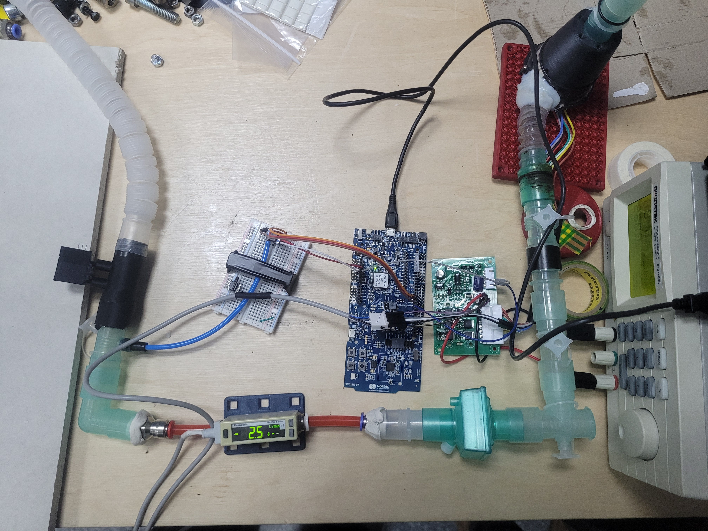
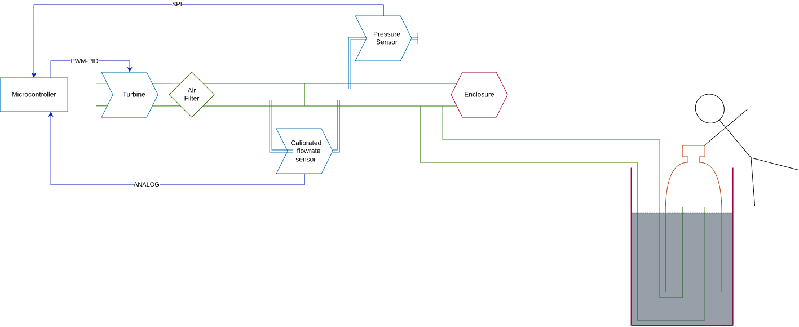
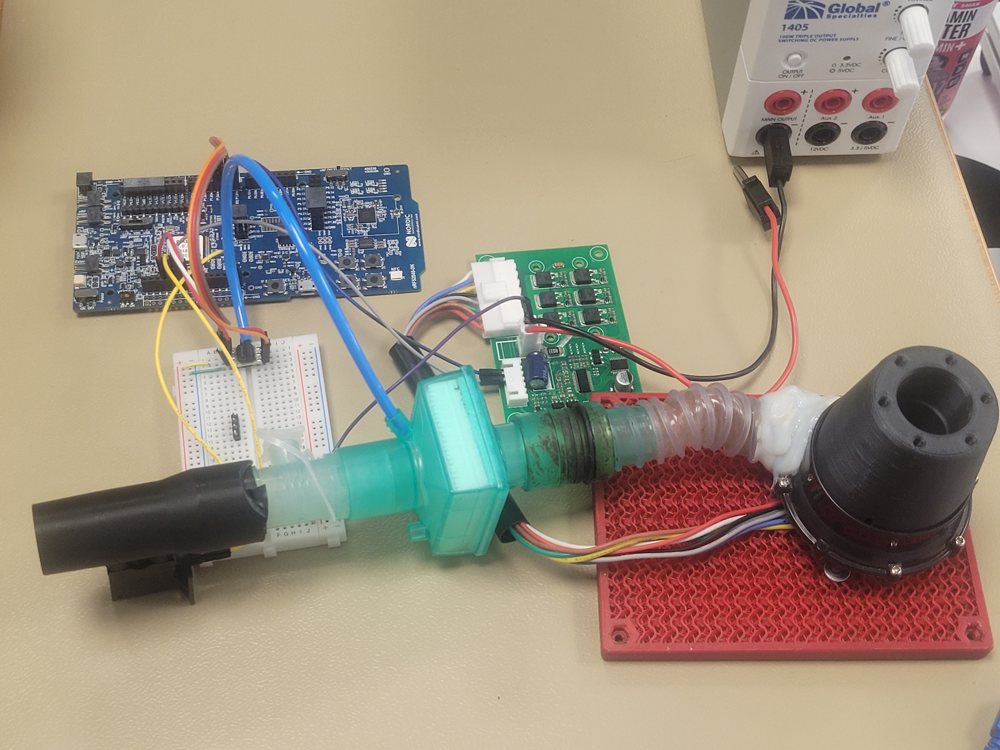
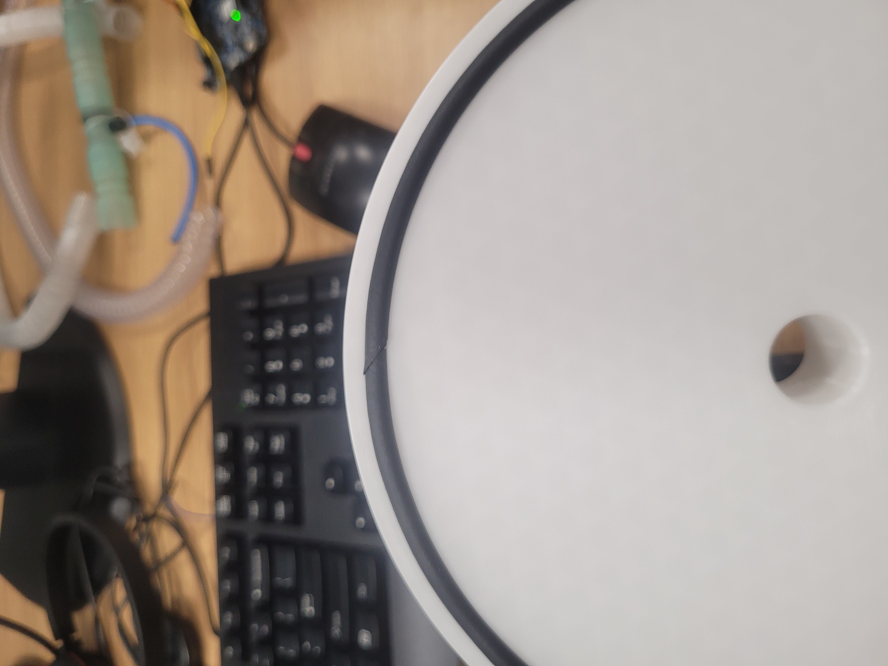
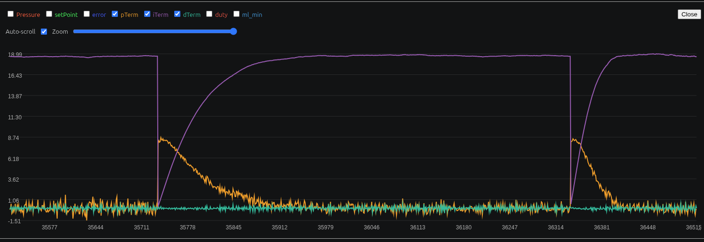
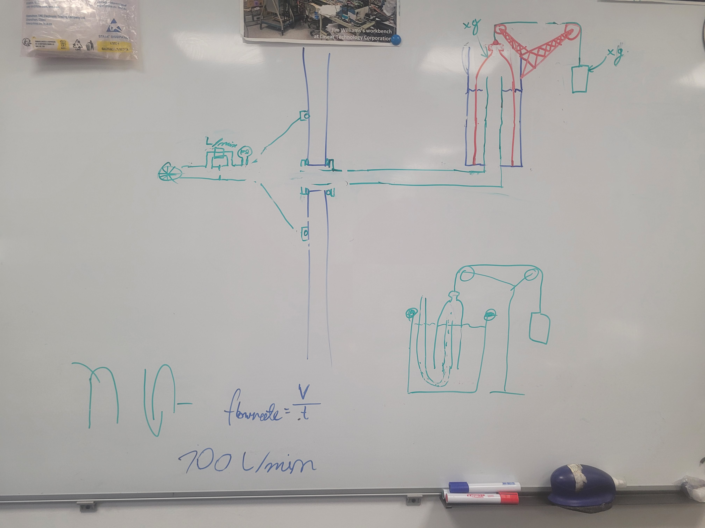
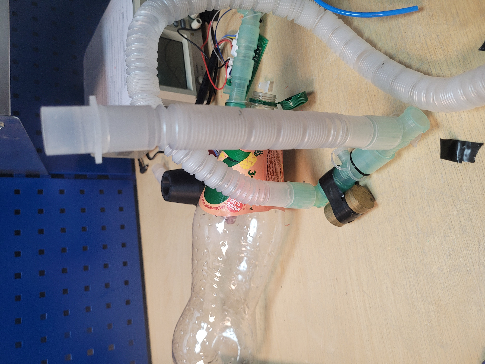

# Enclosure Leak Tester

An enclosure leak tester that measures the airflow required to maintain a constant pressure inside a tested enclosure.

I developed this project independently during an unpaid technical internship at a large company. It started with a real engineering problem encountered during the internship. Since the intended application is internal, I do not publish the company name or identifying details of that use case.

The tester architecture, firmware and custom mechanical design presented here were developed by me.

*Final test setup used for measuring enclosure leakage.*

## How does it work?

A turbine pushes air into the tested enclosure, and a PID controller changes its PWM output to maintain a chosen pressure. A Honeywell differential pressure sensor provides the feedback signal over SPI.

The intended flow measurement uses an Omron D6F-P in a separate bypass. Most of the air travels through the main channel and its restriction; only a small fraction passes through the D6F-P. A calibration would be needed to convert the bypass reading into total airflow.

**What was actually demonstrated:** the final enclosure measurements were made with a separate Panasonic FM-215-8 industrial airflow meter, using the reading on its display, while maintaining an overpressure of 50 Pa. The D6F-P bypass and ADC conversion path were not successfully calibrated by the end of the internship. The journal documents the unsuccessful calibration attempts and the ADC processing problem. The two enclosure readings were 16.8 and 24.6 L/min at 50 Pa, with a separate lid-seal check reading 0 L/min on the reference instrument's display. These are test observations, not a validated accuracy specification for the home-built flow sensor.

*Conceptual diagram of the tester's pneumatic and electronic systems.*

## Main components

- Nordic nRF52840 DK / PCA10056 development board, running Zephyr / nRF Connect SDK
- Omron D6F-P0001A1 airflow sensor for the original bypass measurement path
- Honeywell HSC 002ND series differential pressure sensor (replacing an earlier ABP sensor)
- PWM-controlled turbine / blower
- 3D-printed pneumatic adapters and gasketed measuring lid designed in FreeCAD
- 22 mm conical pneumatic interfaces
- Panasonic FM-215-8, used as an external measurement instrument in the final test setup

*The turbine and electronics during integration.*

## Mechanical design

The pneumatic adapters and measuring lid were designed in FreeCAD. The lid uses a gasket to seal against the tested enclosure, and the adapters use 22 mm conical connections. Source models are under [`3d-models/`](3d-models/).

*Lid and gasket sealing surface during September 29 tests.*

## Electronics and firmware

The Zephyr application is in [`code/release/`](code/release/). Its source modules are `adc`, `spi`, `pid`, `pwm` and `main`.

The release device-tree overlay uses the following nRF52840 signals:

| Signal | Pin / connection in the firmware | Purpose |
| --- | --- | --- |
| ADC input | `NRF_SAADC_AIN7` | Original D6F-P analog signal |
| SPI SCK | `P1.04` | Honeywell pressure sensor clock |
| SPI MISO | `P1.03` | Honeywell pressure sensor data |
| SPI CS | `P1.02` | Honeywell pressure sensor select |
| PWM | `P1.01` | Turbine control signal |
| SW0 | `sw0` devicetree alias | Measurement button |

These are firmware configuration references, not a complete power wiring schematic. Voltage levels, turbine driver requirements and the exact wiring should be verified against the physical components before rebuilding the device. The system diagram and parts reference documents are in [`diagram/`](diagram/) and [`docs/`](docs/).

To work with the firmware, open `code/release/` as a Zephyr / nRF Connect SDK application, select the nRF52840 DK board supported by your installed SDK, and build/flash it using the standard Zephyr workflow. The software is a documented development snapshot, not a validated, calibrated product release.

*Recorded PID controller response from September 22.*

## Airflow calibration

The D6F-P bypass still needs calibration to relate its measured bypass airflow to total airflow. I explored a bell prover using an inverted bottle in a water seal, with displaced volume and elapsed time as the basis of the method.

*Bell prover concept and counterweight idea.*

The prototype used bottles, tubing and a drainage pipe. Manually counterbalancing the bottle led to results that were too inconsistent for a useful reference. During the last day of the internship I also identified an incorrect ADC conversion. This means the earlier flow readings cannot be treated as calibrated readings.

*Prototype calibration setup.*

## Bill of Materials (BOM)

The detailed, itemised parts list is in **[`BOM.csv`](BOM.csv)**. It distinguishes core parts from development and external test equipment. The list is based on the published journal, code, CAD files and photographs.

| Part | Quantity documented | Role / source |
| --- | --- | --- |
| Nordic nRF52840 DK (PCA10056) | 1 | [Board documentation](docs/PCA10056-nRF52840%20Development%20Board%203_0_3/Schematic_Layout%20pdf%20files/PCA10056_Schematic_And_PCB.pdf) |
| Omron D6F-P0001A1 | 1 | [Sensor documentation](docs/D6F-P/D6F-P.pdf) |
| Honeywell HSC 002ND differential sensor | 1 | [HSC reference document](docs/HSCDRRD002NDSA3/3946815.pdf) |
| PWM-driven turbine / blower | 1 | [Integration photo](pictures/camera/integrated-turbine-electronics.jpg); exact model to confirm |
| 3D-printed D6F bypass adapter | 1 design | [Editable model](3d-models/D6F-Resistance/D6F-Resistance-0.3.0-%2820-11.61%29.FCStd) |
| 3D-printed lid with sealing gasket | 1 design | [Editable model](3d-models/measuring-lid-gasket/measuring-lid-gasket_1.0.0.FCStd) |
| Gasket, tubing, connectors and wiring | Quantities to confirm | See `BOM.csv` for references and missing specifications |
| Panasonic FM-215-8 | 1, external test instrument | [Meter documentation](docs/FM-215-8/FM-200-SERIES-INS-EN.pdf); not a required built-in D6F component |

**Cost status:** original purchase prices and several material quantities are not documented in the repository. Consequently, the total cost is **not verified**, and blank cost fields in the CSV are not zero-cost claims. These values must be checked before treating the BOM as a complete purchasing list.

## Known limitations

- The D6F-P bypass has not been reliably calibrated for total airflow.
- The analog ADC conversion path is incomplete in the published firmware; do not interpret its output as calibrated L/min.
- Some part numbers, supply ratings and wiring details need verification from the physical assembly.
- Final measurements used an external Panasonic instrument. They do not validate the D6F-P measurement path.

## Journal

I recorded the development process in **[`JOURNAL.md`](JOURNAL.md)**, including the design decisions, unsuccessful experiments, source code history, mechanical work and final tests. The journal has 18 entries and logs 120 hours. Images use relative Markdown links so they work in the cloned repository and can be rewritten by Forge's Git journal synchronisation.

## Repository

- [`code/release/`](code/release/) contains the final development-stage firmware snapshot
- [`code/stability-test/`](code/stability-test/) and [`code/ai-relay-autotune-test/`](code/ai-relay-autotune-test/) contain test or experimental branches of the work
- [`3d-models/`](3d-models/) contains editable CAD models and printable parts
- [`diagram/`](diagram/) contains system diagrams
- [`docs/`](docs/) contains component documentation and reference material
- [`JOURNAL.md`](JOURNAL.md) documents the development timeline
- [`BOM.csv`](BOM.csv) is the parts inventory for rebuilding and reviewing the project

## License

AGPL-3.0. See [`LICENSE`](LICENSE).
